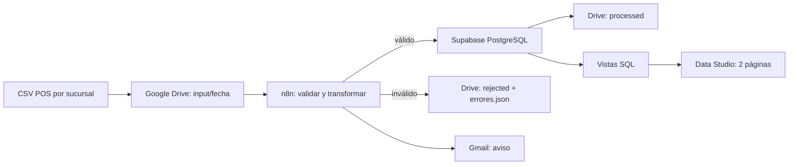

# Cafetería POS BI

**Caso de portafolio con datos ficticios.** El proyecto simula una cafetería pyme con cinco sucursales en CABA. Su objetivo es convertir los CSV diarios exportados por el POS en datos validados para análisis, sin cargar ventas manualmente en una planilla o en el dashboard.

[Ver el informe en Data Studio](https://datastudio.google.com/reporting/e766b5be-9e38-4b20-ab02-e50497bd8e88/page/mKvBG) · El acceso depende de la configuración de uso compartido del informe.

## Qué resuelve

Cada sucursal entrega un archivo `pos_YYYY-MM-DD_S-XX.csv` con líneas de venta. El flujo ETL de n8n lee los archivos desde Google Drive, valida formato y valores, calcula subtotales y totales por ticket, y carga `ventas` y `detalle_ventas` en Supabase PostgreSQL. Los archivos correctos pasan a `processed`; los inválidos a `rejected` con un JSON de errores. Gmail informa el resultado. Data Studio consulta vistas SQL para presentar los indicadores.

## Decisiones principales

- **Granularidad:** una fila por ticket en `ventas` y una por producto del ticket en `detalle_ventas`; `(venta_id, linea_id)` identifica cada línea.
- **Calidad:** se comprueban columnas obligatorias, fecha operativa, sucursal del archivo, cantidades, precios, medios de pago, canales y consistencia de cabecera. PostgreSQL comprueba referencias y `subtotal = cantidad × precio_unitario`.
- **Reintentos:** `import_batches` registra el ID del archivo de Drive. Una segunda ejecución sobre el mismo archivo completado no duplica la carga; los IDs de venta también están protegidos por clave primaria.
- **Trazabilidad:** el archivo se conserva en `processed` o `rejected`; el rechazo incluye sus errores y puede corregirse y reenviarse.
- **Histórico:** la carga inicial y el backfill sintético se hicieron directamente en PostgreSQL; el flujo diario se usa para archivos operativos, no para cargar decenas de miles de tickets de una vez.

## Datos y reporte

Los [CSV crudos iniciales](../data/raw/README.md) cubren del 01/06 al 29/08/2026; un [script reproducible](scripts/preparar_carga_inicial.ps1) los adapta al esquema de Supabase. Un [backfill sintético](supabase/05_backfill_sintetico_2026.sql) agregó 44.835 tickets del 30/08 al 15/11/2026 para completar la serie. El 16/11 se cargaron 15 tickets de **prueba**, por lo que ese día es parcial y no debe compararse con días completos.

El informe tiene dos páginas:

1. **Resumen ejecutivo:** facturación, tickets, ticket promedio, unidades, evolución diaria, sucursales y productos.
2. **Comportamiento de ventas:** medio de pago, franja horaria, canal y categoría.

Data Studio lee vistas PostgreSQL y puede mostrar resultados en caché según la actualización configurada en cada fuente. [Detalle del informe y sus fuentes](data-studio/README.md).

## Estado de la demo

Los workflows se mantienen **desactivados a propósito**. Las pruebas se ejecutaron manualmente: el cierre registró una ejecución correcta el 16/11/2026 y los 15 tickets del día aparecen en Supabase. Esto demuestra la ingesta; no implica que haya un servicio programado operando en producción. Los exports de n8n están sanitizados y requieren configurar credenciales, carpeta raíz y destinatario antes de importarlos en otra instancia.

## Contenido

- [Arquitectura y flujo](docs/arquitectura.md)
- [Contrato de CSV y validaciones](docs/contrato_csv.md)
- [Operación y recuperación de errores](docs/operacion.md)
- [Workflows n8n](n8n/README.md)
- [SQL y orden de carga](supabase/README.md)
- [Fuentes y páginas de Data Studio](data-studio/README.md)
- [Ejemplos de cinco sucursales](data/ejemplos/)

No se publican contraseñas, tokens ni datos de clientes reales.
