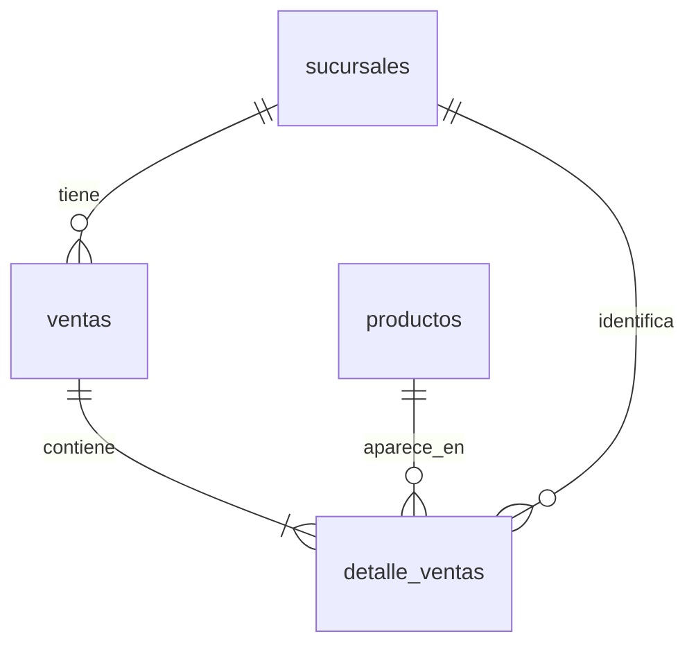

# Arquitectura

## Componentes

| Capa | Función |
| --- | --- |
| POS ficticio | Produce un CSV diario por sucursal, con una fila por producto vendido. |
| Google Drive | Recibe `input/YYYY-MM-DD/` y conserva `processed/` y `rejected/`. |
| n8n | Prepara carpetas, valida y transforma CSV, llama a PostgreSQL y envía avisos por Gmail. |
| Supabase PostgreSQL | Guarda dimensiones, tickets, detalle y estado de cada importación. |
| Data Studio | Consulta vistas SQL para las dos páginas del informe. |

La secuencia de cierre es: localizar la carpeta de la fecha operativa en Argentina → listar los CSV de sucursales → descargar cada archivo → validar y calcular líneas y tickets → invocar `public.process_pos_batch(jsonb)` → mover a `processed` o generar errores y mover a `rejected` → notificar por Gmail.

## Modelo relacional

- `sucursales` y `productos` son catálogos.
- `ventas` contiene la fecha, sucursal, total, medio de pago y canal de cada ticket.
- `detalle_ventas` contiene producto, cantidad, precio y subtotal de cada línea.
- `import_batches` conserva estado, archivo de origen, filas y errores de la ingesta diaria.

Las vistas `vw_ventas_diarias`, `vw_ventas_por_producto`, `vw_ventas_por_medio_pago_canal` y `vw_ventas_por_franja_horaria` sirven al informe. La fecha y las franjas se calculan con `America/Argentina/Buenos_Aires`.

## Separación entre histórico y flujo diario

El histórico inicial se importó desde CSV directamente a PostgreSQL. La serie del 30/08 al 15/11/2026 se completó con SQL sintético identificable por IDs `HGEN-`. Los CSV de operación diaria pasan por n8n y usan IDs `V-`. Esta separación permite probar el control de calidad sin hacer pasar una carga masiva por el workflow de cierre.

## Alcance

Es un prototipo de portafolio, con datos simulados y ejecución manual de las pruebas. No contiene ventas reales ni mide ahorro operativo en una empresa existente. El enlace del informe puede requerir permisos de visualización.
